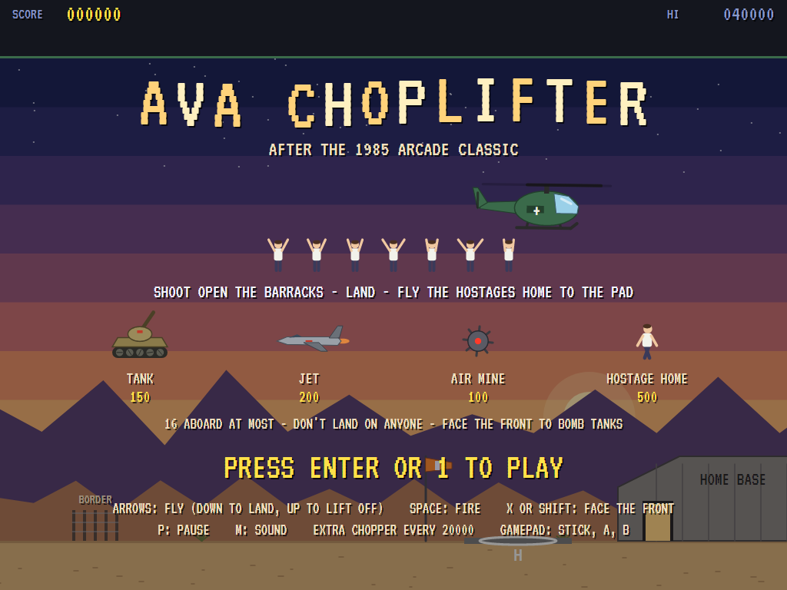
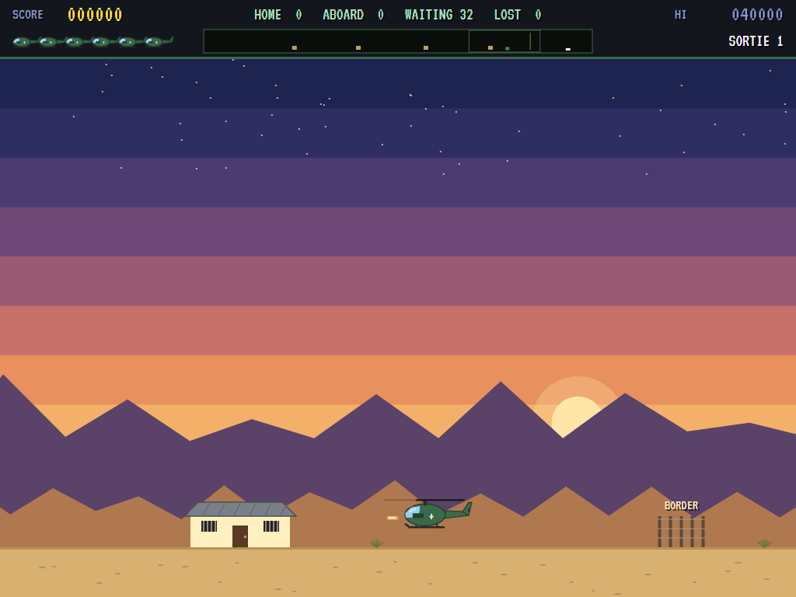
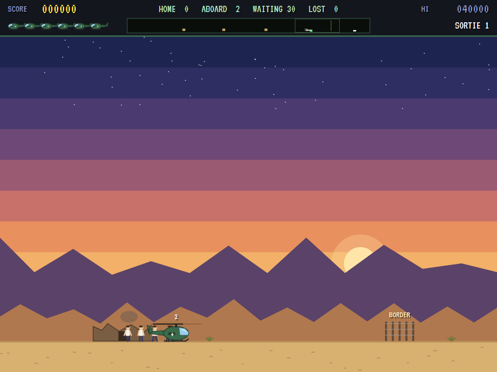
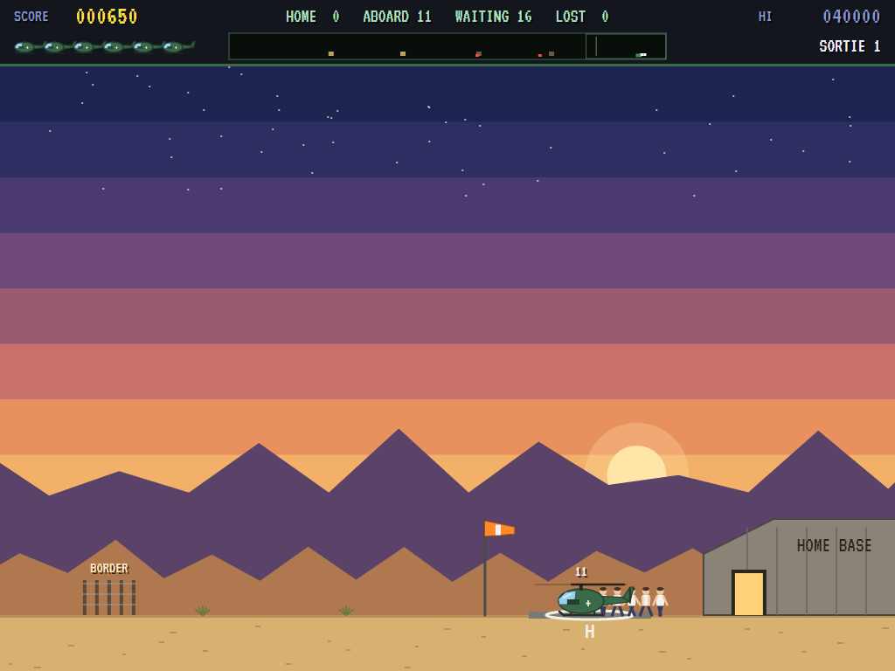
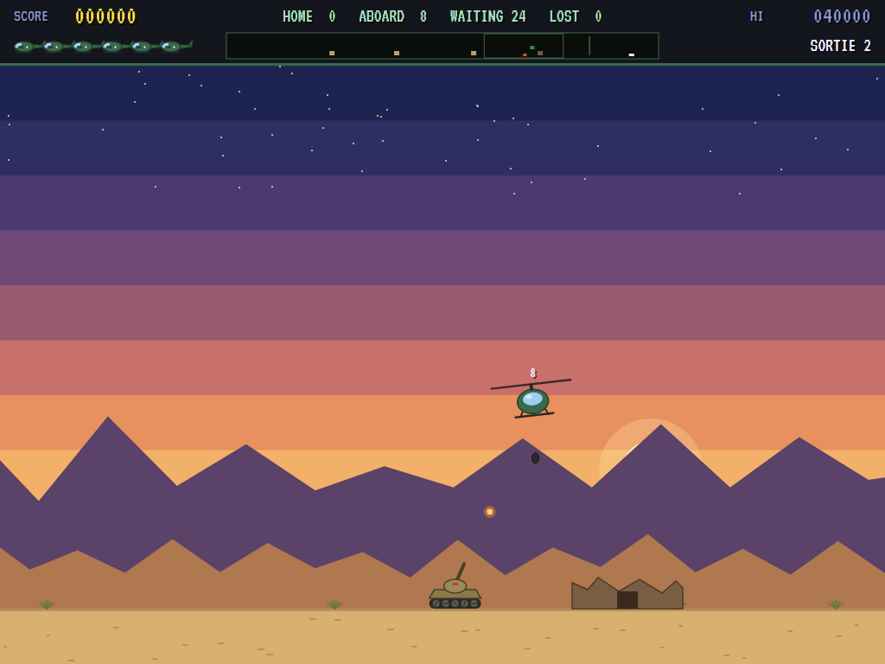
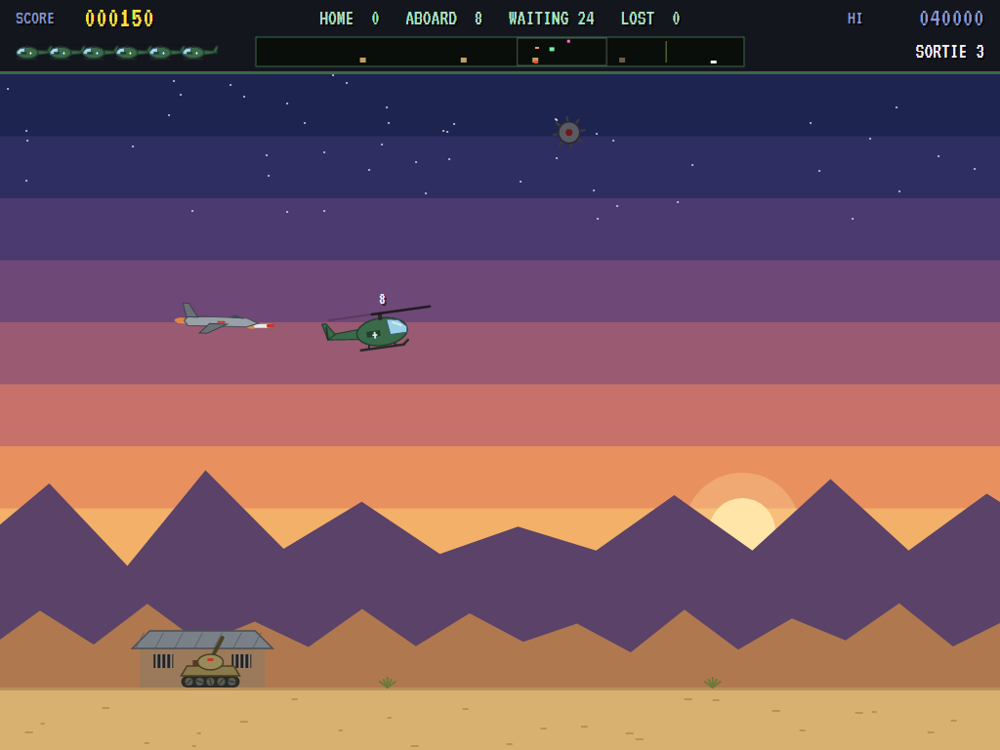
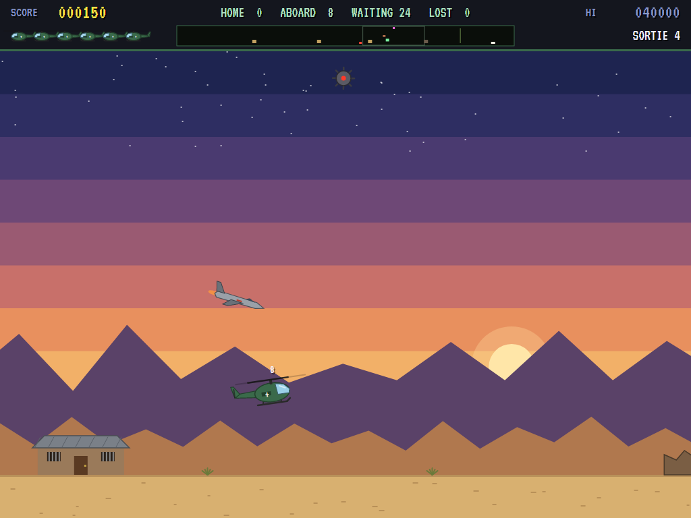
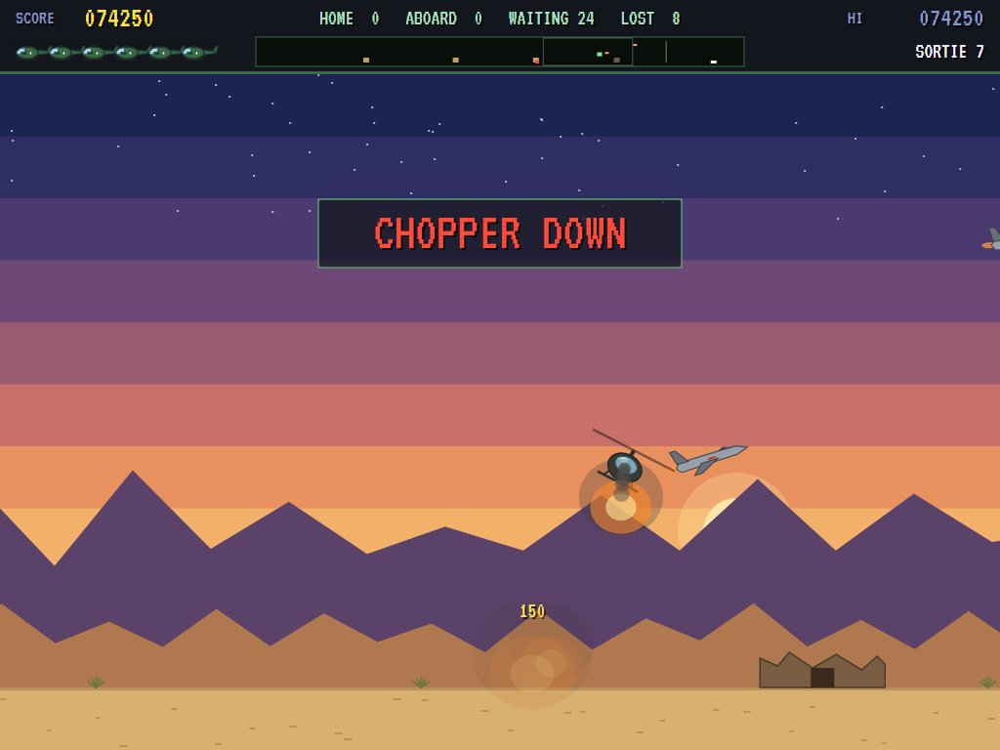
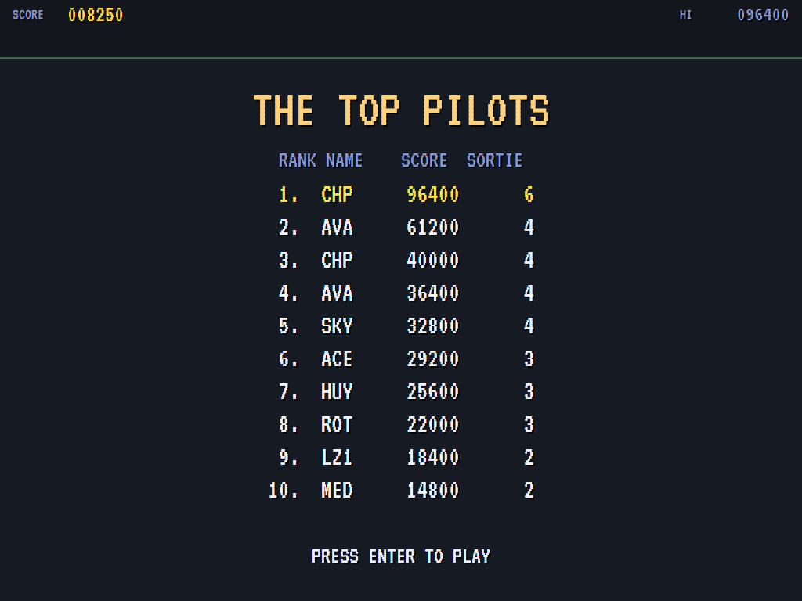

# AVA Choplifter

[](https://github.com/Harlock123/AVAChoplifter/actions/workflows/build.yml)

A helicopter rescue game in the style of Sega's 1985 arcade game **Choplifter**, built with .NET 10 and
Avalonia UI. You fly a rescue chopper out over the border into the desert. Shoot open the barracks where
the hostages are held, set down near them, and wait while they run aboard. Then fly them home to the pad
while tanks shell you from the ground, jets come at you head-on, and air mines drift after you.

## Features

- **The chopper** flies with momentum across and goes straight up and down. Set it down gently to land:
  come down too fast and it crashes. It faces the way you push, and turns to face the front while the
  front button is held:
  - **Facing sideways**, it fires along, three bullets at a time. That hits barracks, jets, mines, and
    tanks if you're low enough.
  - **Facing the front**, it drops bombs that fall with your speed. That's the way to stop a tank.
- **The hostages:**
  - Four barracks along the enemy's side of the strip hold eight hostages each.
  - Three hits break a barracks open, and its hostages come out one at a time to wait.
  - Land within reach and they run for the chopper and climb aboard, 16 at most.
  - Set down on the pad at home and they get off and walk in at the door, 500 each.
  - They can be lost: landed on, caught by a bomb, hit by a low bullet, or run over by a tank. They run
    from a tank coming at them, but may not get away.
  - A chopper shot down takes everyone aboard with it.
- **The enemy** wakes when the first barracks is broken open, or after a while anyway:
  - **Tanks** (150) roll along the ground to get under you, and shell you as you fly.
  - **Jets** (200) come down to your height, fire a missile, pass, and come round again.
  - **Air mines** (100), from the third sortie, drift after the chopper.
  - None of them comes past the border fence, so the base is safe.
- **A sortie** ends when every hostage is home or lost. The bonus is 100 for each one home, times the
  sortie number, plus 5000 if nobody was lost. Each sortie brings more and faster tanks, jets more often,
  and more mines. There's an extra chopper every 20000.
- **The radar** along the top shows the whole strip: barracks, hostages, tanks, jets, mines and you. The
  tally beside it counts those home, aboard, waiting and lost.
- **The attract mode** plays itself. The computer player:
  - shoots open the nearest barracks from low down beside it
  - lands near whoever's waiting, clear of everyone, and stays while they run aboard
  - flies them home when the chopper is full or there's nobody left to fetch
  - turns on jets and mines at its height, and bombs tanks that come close
  - gets out of the way of shells and missiles, and never sets down on anyone
- **The sounds** are all synthesised: the rotor's beat, gunfire, bombs and blasts, jets tearing past, and
  a driving tune.

## Screenshots

| The title | A barracks | Hostages boarding |
|:---------:|:----------:|:-----------------:|
|  |  |  |
| The enemy, and the points. | Shooting it open. | Running for the chopper. |

| Home to the pad | Bombing a tank | A jet |
|:---------------:|:--------------:|:-----:|
|  |  |  |
| Walking in at the door. | Facing the front. | Coming in with a missile. |

| Air mines | Shot down | The high scores |
|:---------:|:---------:|:---------------:|
|  |  |  |
| Drifting after the chopper. | Chopper down. | The top pilots. |

The screenshots are made by the tests, which play the game in a real (headless) window; see
[Tests](#tests).

## Download and run

Ready-to-run builds for Windows, macOS and Linux, on both Intel/AMD and ARM, are on the
[Releases page](https://github.com/Harlock123/AVAChoplifter/releases/tag/latest). **Latest build** is
rebuilt on every push to `main`. Each download is one self-contained executable: no .NET install is
needed.

| Platform | Archive |
|---|---|
| Windows | `AVAChoplifter-win-x64.zip`, `AVAChoplifter-win-x86.zip`, `AVAChoplifter-win-arm64.zip` |
| macOS | `AVAChoplifter-osx-arm64.tar.gz` (Apple silicon), `AVAChoplifter-osx-x64.tar.gz` (Intel) |
| Linux | `AVAChoplifter-linux-x64.tar.gz`, `AVAChoplifter-linux-arm64.tar.gz`, `AVAChoplifter-linux-arm.tar.gz` |

```bash
tar -xzf AVAChoplifter-linux-x64.tar.gz     # or linux-arm64, linux-arm, osx-arm64, osx-x64
./AVAChoplifter
```

On Windows, unzip and run `AVAChoplifter.exe`. On macOS, if Gatekeeper refuses to open it, run
`xattr -d com.apple.quarantine AVAChoplifter` once. Run with `--no-audio` for silence.

**Sound** comes through OpenAL Soft, built in for every platform. In a virtual machine the game
detects it and uses a larger audio buffer, so the sound doesn't break up.

**Gamepads** use SDL2, which is bundled for Windows, macOS and Intel/AMD Linux. ARM Linux builds need it
installed; without it the keyboard still works:

```bash
sudo apt install libsdl2-dev            # Debian / Ubuntu / Raspberry Pi OS
sudo pacman -S --needed sdl2-compat     # Arch / Omarchy
```

## Controls

| Action | Keyboard | Gamepad |
|---|---|---|
| Start | Enter or 1 | Start |
| Fly (down to land, up to lift off) | Arrow keys (or W A S D) | Left stick / D-pad |
| Fire (bullets sideways, bombs facing the front) | Space, Z or Ctrl | A or right trigger |
| Face the front (while held) | X, C or Shift | B, X or left trigger |
| Pause | P or Esc | Start |
| Quit (while paused) | Esc | Back |
| Sound on/off | M | |
| Screenshot | Ctrl+S (to your Pictures folder) | |

On the high-score table, type your initials, or use up/down and Space, then Enter.

## Tests

```bash
dotnet test AVAChoplifter.slnx
```

The engine has no UI and runs in fixed 60 Hz steps, so it plays the same at any frame rate, and a seed
always plays the same game. The tests check:

- **The strip:** four barracks of hostages spread out on the enemy's side of the border, the same each
  time, and later sorties bringing more and faster tanks, jets more often, and mines from the third
- **The chopper:**
  - lifting off the pad, gathering speed and coasting, and going straight up and down
  - landing gently and crashing coming down fast
  - facing the way it's pushed and the front while that's held, and a moment to turn
  - bullets along, three at a time, and bombs that fall
- **The hostages:**
  - a barracks opening at the third hit, its hostages coming out, and the enemy waking
  - running for the landed chopper, 16 aboard at most, and waiting again when it takes off
  - those far off staying put
  - being landed on, bombed or shot
  - getting off at the pad and walking in, 500 each
- **The enemy:**
  - nothing coming until a barracks is opened or time has passed
  - a tank getting under the chopper and shelling it, and a chopper lost with those aboard
  - bombs and low bullets for tanks, tanks keeping to their side of the border
  - hostages running from tanks, and being run over
  - jets coming down to fire, being shot down, and flying into one
  - air mines drifting after the chopper
- **The machine:**
  - the sortie ending with its bonus, and extra choppers
  - the last chopper lost, and initials
  - the title, demonstration and high scores, and starting a game on the pad
  - the arrow keys flying the right way
  - the computer player bringing most of the first sortie home, and firing blindly bringing nobody

The screenshot tests draw the real screen in a headless window. To refresh the README's pictures:

```bash
CHOPLIFTER_SHOTS=$PWD/Images dotnet test tests/AVAChoplifter.Tests --filter ScreenshotTests
```

To see how the computer player gets on, sortie by sortie (`1` for the pilot, `lazy` for one that sweeps
back and forth firing all the time):

```bash
CHOPLIFTER_PROBE=1 dotnet test tests/AVAChoplifter.Tests --filter PilotProbe --logger "console;verbosity=detailed"
```

## Building

```bash
dotnet build AVAChoplifter.slnx
dotnet run --project src/AVAChoplifter
```

Needs the .NET 10 SDK. The sounds are made by `tools/make_sounds.py` (standard-library Python):
`python3 tools/make_sounds.py` rewrites `src/AVAChoplifter/Sounds`.

## Project structure

```
AVAChoplifter/
├── AVAChoplifter.slnx
├── src/AVAChoplifter/
│   ├── Engine/
│   │   ├── GameEngine.cs        # States, the title and demo cycle, the music
│   │   ├── GameEngine.Play.cs   # The chopper, the barracks and hostages, tanks, jets and mines, scoring
│   │   ├── ChopperPilot.cs      # The computer player, for the demonstration (and the tests)
│   │   ├── Entities.cs          # The strip, the chopper, and everything on it
│   │   ├── HighScoreTable.cs, InitialsEntry.cs
│   │   ├── InputHandler.cs, ControllerManager.cs  # Keys and an SDL2 gamepad
│   │   └── SoundManager.cs      # Effects and the tunes through OpenAL
│   ├── Audio/                   # The OpenAL engine (from the author's AVABand)
│   ├── Views/                   # The drawing: the desert, the base, the chopper, the enemy, the radar, the screens
│   └── Sounds/                  # The synthesised effects and tunes
├── tests/AVAChoplifter.Tests/   # Gameplay, screenshot and probe tests
├── tools/make_sounds.py
└── Images/                      # Screenshots
```

## About and licence

AVA Choplifter © 2026 Lonnie Watson, under the [MIT License](LICENSE).

*Choplifter* © 1982 Dan Gorlin and Broderbund, arcade version © 1985 Sega; the name belongs to its current
owner. AVA Choplifter is an independent, unofficial game in its style. Its chopper, enemy, desert and base,
its graphics, sounds, tunes and code are its own; nothing is taken from the original games' programs,
graphics, sound or music. It is not affiliated with or endorsed by any rights holder.
